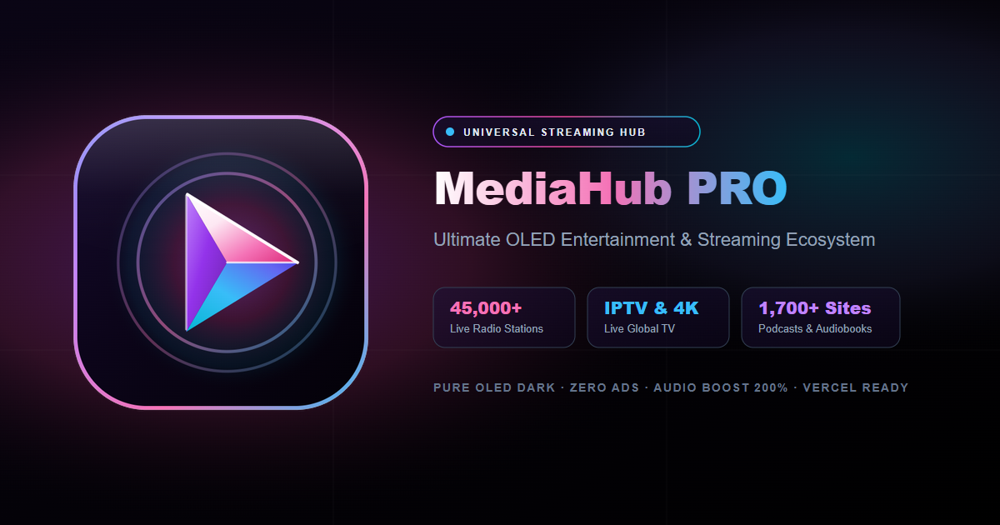

<div align="center">



<br>

# media-hub

### One interface. Every kind of media.

A self-hostable media platform for live radio, television, YouTube, podcasts, audiobooks and universal URL playback — backed by a Python API and a React-based player.

<br>

<a href="https://media-hub-ad-free.vercel.app">
  
</a>
&nbsp;
<a href="https://github.com/Hidden-Rhythm/media-hub">
  
</a>

<br><br>


<br><br>

[Live application](https://media-hub-ad-free.vercel.app) · [REST API](https://media-hub-ad-free.vercel.app/api/docs) · [Report an issue](https://github.com/Hidden-Rhythm/media-hub/issues)

<br>

*Built by [Hidden-Rhythm](https://github.com/Hidden-Rhythm)*

</div>

---

## 01 / Overview

**media-hub** brings multiple media sources into a single application instead of splitting the experience across separate players and discovery interfaces.

The frontend is built with React and Vite. A Flask backend powers media discovery, stream extraction, API responses, and streaming-related utilities. A shared player context connects playback controls and media views, while browser storage keeps selected preferences and favorites between visits.

The project is designed around three principles:

- **Unified discovery** — search and explore different media categories from one interface.
- **A shared playback experience** — consistent controls for compatible audio and video sources.
- **An accessible developer interface** — use the application visually or query its REST API directly.

<div align="center">

| DISCOVER | PLAY | BUILD |
|:---:|:---:|:---:|
| Radio, TV, video and audio | Shared player and playback tools | Flask REST API and stream utilities |

</div>

## 02 / What’s included

<table>
<tr>
<td width="50%" valign="top">

### 📻 Radio

- Indian and international station discovery
- Search by station and genre
- Country and category filters
- Live audio playback
- Favorites and shared player controls

</td>
<td width="50%" valign="top">

### 📺 Live television

- Country-based channel browsing
- Search and genre filtering
- Live channel playback
- HLS playback support
- Electronic programme guide integration

</td>
</tr>
<tr>
<td width="50%" valign="top">

### ▶ YouTube

- Video search and discovery
- Trending and live feeds
- Relevance, popularity and recency sorting
- URL-based media extraction
- Shared video playback interface

</td>
<td width="50%" valign="top">

### 🎙 Podcasts

- Indian and global discovery
- Searchable podcast catalogues
- RSS feed episode retrieval
- Episode playback where supported
- Favorites and playback controls

</td>
</tr>
<tr>
<td width="50%" valign="top">

### 📚 Audiobooks

- Indian and international collections
- Category-based browsing
- Book search
- Chapter retrieval
- Chapter-aware listening interface

</td>
<td width="50%" valign="top">

### 🔗 Universal URL player

- Paste a supported media URL
- Extract playable media through the backend
- Select extraction quality where available
- Keep a recent-URL history
- Support for direct media URLs and compatible third-party sources

</td>
</tr>
<tr>
<td width="50%" valign="top">

### 🎵 Lyrics and metadata

- Lyrics retrieval by title and artist
- Synchronized lyrics when available
- Media metadata enrichment
- Subtitle-related backend functionality

</td>
<td width="50%" valign="top">

### ⚙ Personalization

- Six selectable visual themes
- Favorites stored in browser storage
- Playback queue and lyrics drawer
- Sleep timer and volume boost
- Fullscreen and picture-in-picture controls

</td>
</tr>
</table>

> **Source compatibility:** A media source can become unavailable, restrict embedding, require particular headers, or use a format unsupported by the browser. The application provides discovery and playback tooling; it cannot guarantee that every third-party source will remain accessible.

## 03 / Explore the application

| Route | Purpose |
|---|---|
| `/` | Home and featured modules |
| `/radio` | Radio discovery and live stations |
| `/tv` | Live television and channel browsing |
| `/youtube` | Search, trending videos and live content |
| `/podcasts` | Podcast discovery and episodes |
| `/audiobooks` | Audiobook discovery and chapters |
| `/universal` | Extract media from a supported URL |
| `/api-hub` | Explore and test API requests |
| `/favorites` | Access saved media |
| `/settings` | Themes and application preferences |

### The player

The shared player is managed through `PlayerProvider` and `usePlayer` in `src/context/PlayerContext.jsx`.

Depending on the selected source, the interface includes playback, seeking, volume, mute, playback speed, queue management, lyrics, video display, and related media actions.

Additional interface components include:

- `PlayerBar.jsx` — the shared player controls.
- `QueueDrawer.jsx` — the playback queue interface.
- `LyricsDrawer.jsx` — the lyrics interface.
- `VideoOverlay.jsx` — the video viewing surface.
- `Modals/` — sleep timer, metadata, EPG, chapters, themes, shortcuts and confirmation dialogs.

### Themes

Choose from six built-in themes in Settings or cycle through them using the `T` shortcut.

| Theme | Visual direction |
|---|---|
| OLED Pure Black | Black with violet and fuchsia accents |
| Cyberpunk Neon | Cyan and pink |
| Emerald & Gold | Green and gold |
| Crimson Velvet | Ruby red and violet |
| Abyssal Ocean | Blue and cyan |
| Cosmic Amethyst | Violet and lavender |

The selected theme is persisted in browser storage.

## 04 / Keyboard shortcuts

The following shortcuts are registered by the application shell. Availability may depend on the active media and browser.

| Shortcut | Action |
|:---:|---|
| `Space` | Play or pause |
| `M` | Toggle mute |
| `L` | Open or close lyrics |
| `T` | Cycle visual themes |
| `Shift + /` | Open the shortcuts dialog |
| `F` | Toggle the video overlay for video media; otherwise toggle fullscreen |
| `F11` | Toggle fullscreen |
| `P` | Toggle picture-in-picture when supported |
| `←` | Seek backward 5 seconds |
| `→` | Seek forward 5 seconds |
| `↑` | Increase volume by 5% |
| `↓` | Decrease volume by 5% |

Shortcuts are ignored when focus is inside standard input, select or textarea elements.

---

## 05 / Getting started

### Prerequisites

Install the following before running the project:

- **Node.js and npm** — for the React/Vite frontend.
- **Python** — for the Flask backend.
- **Git** — to clone the repository.

### 1. Clone the repository

```bash
git clone https://github.com/Hidden-Rhythm/media-hub.git
cd media-hub
```

### 2. Install frontend dependencies

```bash
npm install
```

### 3. Create a Python virtual environment

**Windows — PowerShell**

```powershell
py -m venv .venv
.\.venv\Scripts\Activate.ps1
python -m pip install --upgrade pip
pip install -r requirements.txt
```

If PowerShell blocks activation, you can use Command Prompt instead:

```bat
.venv\Scripts\activate.bat
python -m pip install --upgrade pip
pip install -r requirements.txt
```

**macOS / Linux**

```bash
python3 -m venv .venv
source .venv/bin/activate
python -m pip install --upgrade pip
pip install -r requirements.txt
```

The Python dependencies include Flask, Flask-CORS, Requests, `pyradios`, `yt-dlp`, `audiobooker`, `feedparser`, `syncedlyrics`, and Pillow.

### 4. Start the Flask backend

From the repository root, with the Python environment activated:

```bash
python app.py
```

The Flask application starts on:

```text
http://127.0.0.1:5000
```

You can check the API documentation at:

```text
http://127.0.0.1:5000/api/docs
```

Keep this terminal open while using the frontend in development.

### 5. Start the frontend

Open a **second terminal** in the same repository and run:

```bash
npm run dev
```

Vite is configured to use port `3000`. Open:

```text
http://localhost:3000
```

The development server forwards `/api` and `/stream` requests to the Flask service on port `5000`.

### Local development at a glance

```text
Browser
  │
  ▼
React + Vite
localhost:3000
  │
  ├── /api/* ─────────┐
  │                   │
  └── /stream/* ──────┤
                      ▼
                Flask backend
              127.0.0.1:5000
                      │
             ┌────────┴────────┐
             │                 │
        Media providers    Stream / EPG
```

**Important:** Running only `npm run dev` starts the frontend, not the Flask API. Features that depend on backend endpoints will fail unless the backend is running and reachable.

---

## 06 / Configuration

### Optional TMDB key

The repository includes `.env.example` with an optional `TMDB_KEY` setting for movie and series metadata enrichment. The application also exposes a TMDB key field in its Settings interface.

The app can be used without configuring this key; metadata enrichment may be limited when it is absent.

To set the environment variable for the current PowerShell session:

```powershell
$env:TMDB_KEY = "your_tmdb_api_key"
python app.py
```

For Command Prompt:

```bat
set TMDB_KEY=your_tmdb_api_key
python app.py
```

For macOS or Linux:

```bash
export TMDB_KEY="your_tmdb_api_key"
python app.py
```

These commands set the variable for the current terminal session. They do not permanently configure Windows or other operating-system environments.

**Keep API keys private.** Do not commit real credentials to the repository. If you use the in-app settings, the frontend saves its TMDB key in browser local storage, so only use that on a device and browser profile you trust.

---

## 07 / REST API

Media Hub exposes a Flask REST API for its discovery and playback-related features. The API documentation routes are implemented in `app.py`.

### API documentation

Once the backend is running, open:

- [`/api/docs`](http://127.0.0.1:5000/api/docs) — developer-friendly API documentation.
- [`/api/info`](http://127.0.0.1:5000/api/info) — API information.
- [`/api`](http://127.0.0.1:5000/api) — API documentation response.

### Endpoint reference

| Endpoint | Purpose | Common parameters |
|---|---|---|
| `GET /api/universal` | Unified search across media providers | `q`, `country`, `limit`, `sources`, `url` |
| `GET /api/all` | Alias for unified search | Same as above |
| `GET /api/search` | Alias for unified search | Same as above |
| `GET /api/youtube/search` | Search YouTube media | `q`, `cat`, `sort`, `limit` |
| `GET /api/youtube/trending` | Trending video feed | `cat`, `limit` |
| `GET /api/youtube/live` | Live video discovery | `q`, `cat`, `limit` |
| `GET /api/youtube/extract` | Extract media information from a video URL | `url`, `quality` |
| `GET /api/radio/search` | Search radio stations | `name` or `q`, `country`, `tag`, `limit` |
| `GET /api/tv/channels` | Retrieve TV channels | `country`, `category`, `q` |
| `GET /api/podcasts/search` | Search podcasts | `q`, `country`, `limit` |
| `GET /api/podcasts/episodes` | Retrieve podcast episodes | `feed`, `limit` |
| `GET /api/audiobooks/search` | Search audiobooks | `q`, `region`, `cat`, `limit` |
| `GET /api/audiobooks/chapters` | Retrieve audiobook chapters | `id` or `identifier` |
| `GET /api/universal/play` | Extract a URL for playback | `url`, `quality` |
| `GET /api/stream` | Select a stream proxy strategy | `url`, `type` |
| `GET /api/stream/proxy` | Proxy a media resource | `url` |
| `GET /api/stream/hls` | Rewrite and proxy HLS playlists | `url` |
| `GET /api/epg/load` | Load an XMLTV programme guide | `url` |
| `GET /api/epg/now` | Retrieve current/next programme data | `tvg_id` |

Other routes support lyrics, metadata and subtitle-related functionality. Use `/api/docs` for the live API documentation rather than assuming every endpoint accepts the same parameters.

### Example 1 — Unified search

```bash
curl "http://127.0.0.1:5000/api/universal?q=lofi&country=GLOBAL&limit=6"
```

The unified endpoint aggregates results from selected media sources and returns a JSON response with source-specific results and a normalized feed.

Choose particular sources with the `sources` parameter:

```text
/api/universal?q=lofi&sources=youtube,radio&country=GLOBAL&limit=5
```

### Example 2 — Search YouTube

```bash
curl "http://127.0.0.1:5000/api/youtube/search?q=lofi&limit=10"
```

### Example 3 — Search radio

```bash
curl "http://127.0.0.1:5000/api/radio/search?name=jazz&country=GLOBAL&limit=10"
```

### Example 4 — Search podcasts

```bash
curl "http://127.0.0.1:5000/api/podcasts/search?q=technology&country=GLOBAL&limit=10"
```

### Example 5 — Extract a media URL

```bash
curl "http://127.0.0.1:5000/api/universal/play?url=https%3A%2F%2Fexample.com%2Fmedia.mp4"
```

Replace the example URL with a source you are authorized to access and that the extractor supports.

### Use the API Hub in the browser

You can also open the application’s **API Hub** view at `/api-hub`. It provides a request interface with source selection, query settings, response timing, and code examples for cURL, JavaScript, Python and Dart.

The API Hub is useful for trying a request before integrating it into another project.

---

## 08 / Production build and deployment

### Build the frontend

```bash
npm run build
```

Vite writes the frontend production bundle to `dist/`.

### Preview the production frontend

```bash
npm run preview
```

Use the URL printed in the terminal to test the generated frontend bundle.

### Flask deployment

The Flask app can serve the built frontend when `dist/index.html` exists. Its entry point is `app.py`, and the Vercel serverless entry point imports the Flask app through `api/index.py`.

The repository also contains `data/dishtv_channels.json`, used as part of the project's TV channel data, and `epg.py` for programme-guide handling.

### Vercel considerations

A successful frontend deployment does not automatically guarantee that every backend feature or external stream will work. Production must route API requests to the Flask serverless entry point or another suitable backend deployment.

The Vite proxy in `vite.config.js` is a **development-only configuration**. It forwards `/api` and `/stream` to `127.0.0.1:5000` during local development; it does not configure Vercel's production routing.

Check the deployment's routing configuration and function logs if the frontend loads but API requests fail.

---

## 09 / Project structure

The following tree reflects the main source files and directories in the repository.

```text
media-hub/
├── api/
│   └── index.py
├── data/
│   └── dishtv_channels.json
├── public/
│   ├── favicon.svg
│   ├── manifest.json
│   └── og-image.png
├── src/
│   ├── components/
│   │   ├── Modals/
│   │   │   ├── ChaptersModal.jsx
│   │   │   ├── ConfirmModal.jsx
│   │   │   ├── EpgModal.jsx
│   │   │   ├── MetadataModal.jsx
│   │   │   ├── ShortcutsModal.jsx
│   │   │   ├── SleepTimerModal.jsx
│   │   │   └── ThemeModal.jsx
│   │   ├── Views/
│   │   │   ├── ApiHubView.jsx
│   │   │   ├── AudiobooksView.jsx
│   │   │   ├── FavoritesView.jsx
│   │   │   ├── HomeView.jsx
│   │   │   ├── PodcastsView.jsx
│   │   │   ├── RadioView.jsx
│   │   │   ├── SettingsView.jsx
│   │   │   ├── TVView.jsx
│   │   │   ├── UniversalView.jsx
│   │   │   └── YouTubeView.jsx
│   │   ├── Icons.jsx
│   │   ├── LyricsDrawer.jsx
│   │   ├── PlayerBar.jsx
│   │   ├── QueueDrawer.jsx
│   │   ├── Sidebar.jsx
│   │   ├── ToastContainer.jsx
│   │   └── VideoOverlay.jsx
│   ├── context/
│   │   └── PlayerContext.jsx
│   ├── App.jsx
│   ├── index.css
│   └── main.jsx
├── .env.example
├── app.py
├── epg.py
├── index.html
├── package.json
├── postcss.config.js
├── providers.py
├── requirements.txt
└── vite.config.js
```

### Core files

| File | Responsibility |
|---|---|
| `app.py` | Flask application, REST endpoints and stream proxy routes |
| `api/index.py` | Vercel serverless entry point for Flask |
| `providers.py` | Radio, TV, YouTube, universal URL, podcast, audiobook, lyrics, metadata and subtitle providers |
| `epg.py` | XMLTV programme-guide parsing and EPG services |
| `data/dishtv_channels.json` | DishTV channel data |
| `src/App.jsx` | Application shell, view navigation, keyboard shortcuts and modal integration |
| `src/context/PlayerContext.jsx` | Shared playback state, favorites, theme preferences and player actions |
| `src/components/Views/` | Individual media and settings screens |
| `src/components/Modals/` | Modal interfaces used by the application |
| `vite.config.js` | Development server, API/stream proxy and build configuration |
| `package.json` | Frontend dependencies and npm scripts |
| `requirements.txt` | Python dependencies |
| `.env.example` | Optional environment configuration example |

---

## 10 / Troubleshooting

### Frontend opens, but media searches fail

Confirm that the Flask backend is running:

```bash
python app.py
```

Then open the API documentation directly at `http://127.0.0.1:5000/api/docs`. If that fails, investigate the Python environment and backend logs before debugging the frontend.

### `pip install` fails

Make sure the virtual environment is activated and that you are using a supported Python installation.

```bash
python --version
python -m pip --version
pip install -r requirements.txt
```

Some media providers rely on external services or extractor behavior that can change independently of this project.

### A media URL cannot be extracted

Check that the URL is valid, publicly accessible where required, and supported by the installed extraction provider. Some sites restrict automated extraction, embeds or direct playback. A failed extraction does not necessarily indicate a broken player.

### HLS video does not play

Possible causes include an unavailable upstream playlist, invalid HLS segments, browser restrictions, network failures, or source-side access requirements. Try another compatible source and inspect the browser's network and console panels.

### API works locally but not on Vercel

The local Vite proxy is not a production proxy. Verify that production API requests are routed to the deployed Flask function and that the function can import its dependencies. Check Vercel's function logs for import errors, request timeouts or upstream service failures.

### TMDB enrichment is missing

TMDB is optional. Check the API key in Settings if you need the in-app configuration, or set `TMDB_KEY` in the backend's runtime environment when using environment-based configuration.

---

## 11 / Technology

<table>
<tr><th>Layer</th><th>Technologies</th></tr>
<tr><td>Frontend</td><td>React 19, React DOM, Vite 8</td></tr>
<tr><td>Styling</td><td>Tailwind CSS 4, PostCSS, Autoprefixer</td></tr>
<tr><td>Interface</td><td>Lucide React, clsx, tailwind-merge</td></tr>
<tr><td>Backend</td><td>Python, Flask, Flask-CORS, Requests</td></tr>
<tr><td>Media extraction</td><td>yt-dlp, HLS.js</td></tr>
<tr><td>Audio and discovery</td><td>pyradios, feedparser, audiobooker, syncedlyrics</td></tr>
<tr><td>Metadata and images</td><td>Pillow, optional TMDB integration</td></tr>
<tr><td>Deployment</td><td>Vite production build, Flask, Vercel serverless entry point</td></tr>
</table>

## 12 / Contributing

Contributions that improve source reliability, playback compatibility, accessibility, API behavior, or maintainability are welcome.

1. Fork the repository.
2. Create a feature branch.
3. Install the frontend and backend dependencies.
4. Test the relevant application view and API endpoint.
5. Run the production frontend build.
6. Submit a pull request describing the change and any relevant limitations.

Before submitting frontend changes:

```bash
npm run build
```

For backend changes, also test the affected API endpoint locally.

## 13 / Project information

| | |
|---|---|
| Project | media-hub |
| Author | [Hidden-Rhythm](https://github.com/Hidden-Rhythm) |
| Frontend | React + Vite |
| Backend | Flask |
| Package version | `1.0.0` |
| Declared package license | ISC |
| Live application | [media-hub-ad-free.vercel.app](https://media-hub-ad-free.vercel.app) |
| Repository | [Hidden-Rhythm/media-hub](https://github.com/Hidden-Rhythm/media-hub) |

The package metadata declares the ISC license. Verify the repository's license file before redistributing the project.

---

<div align="center">


<br>

### media-hub

**A single place to discover, play and work with media.**

Built with care by **[Hidden-Rhythm](https://github.com/Hidden-Rhythm)**

<br>

[Live demo](https://media-hub-ad-free.vercel.app) · [Source code](https://github.com/Hidden-Rhythm/media-hub) · [Issues](https://github.com/Hidden-Rhythm/media-hub/issues)

</div>
